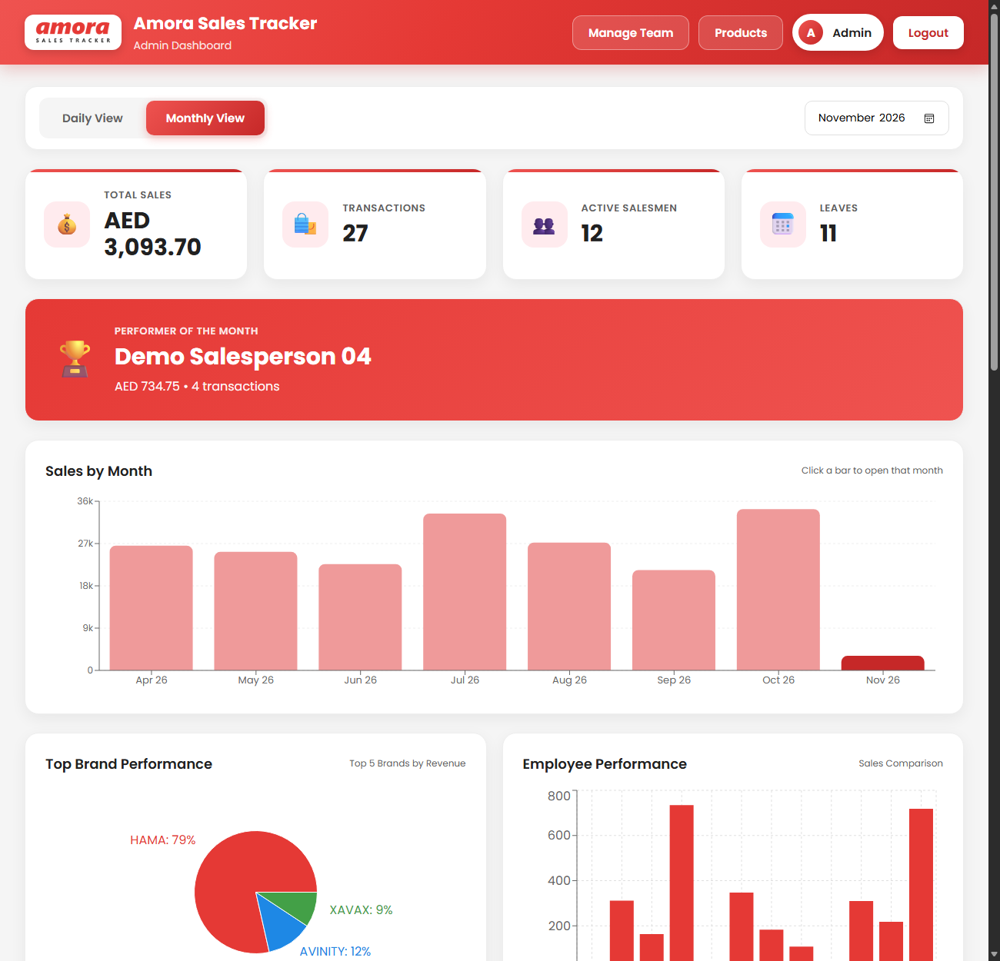
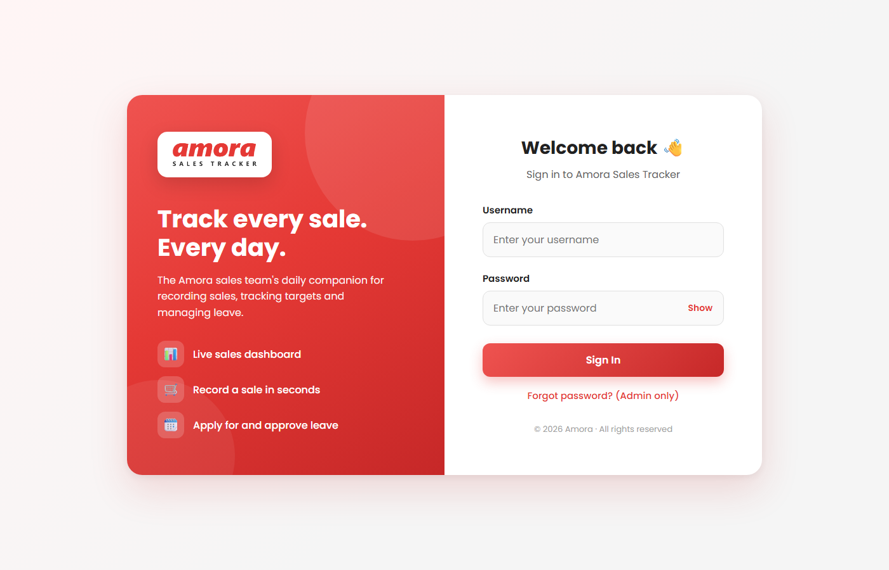
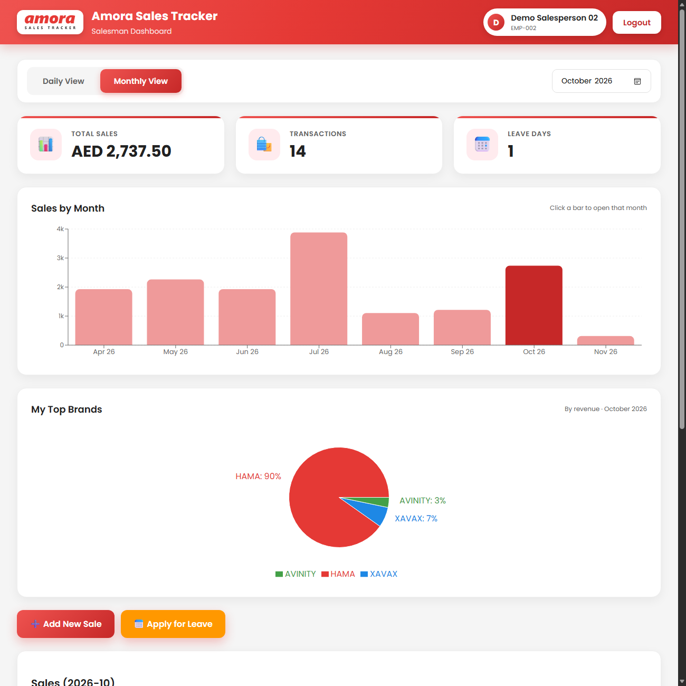
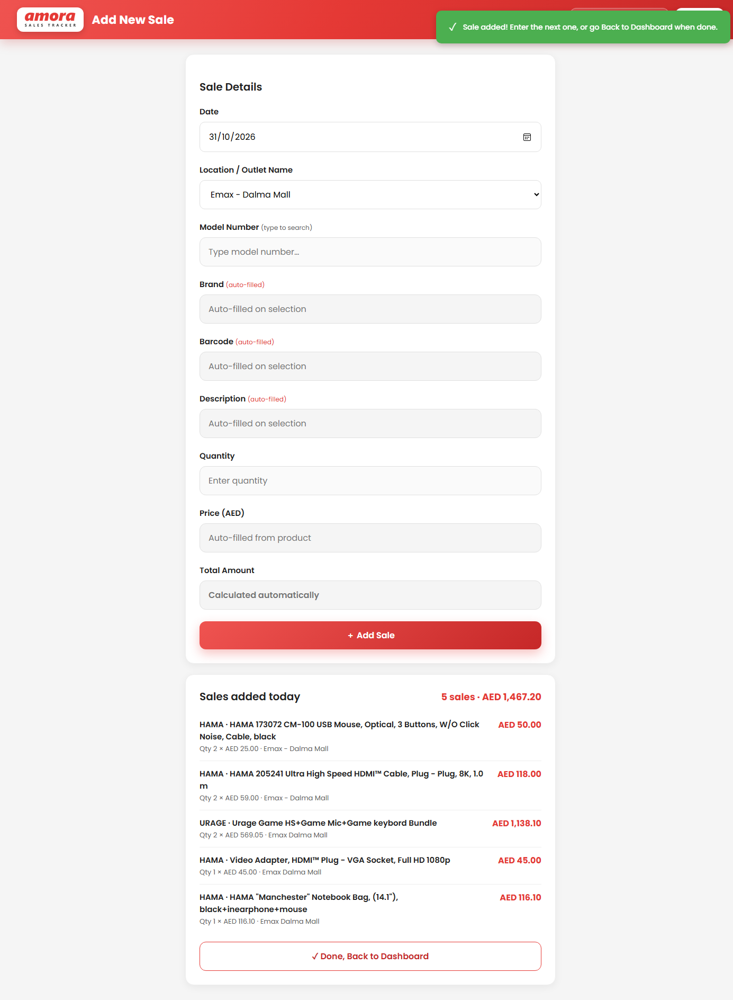
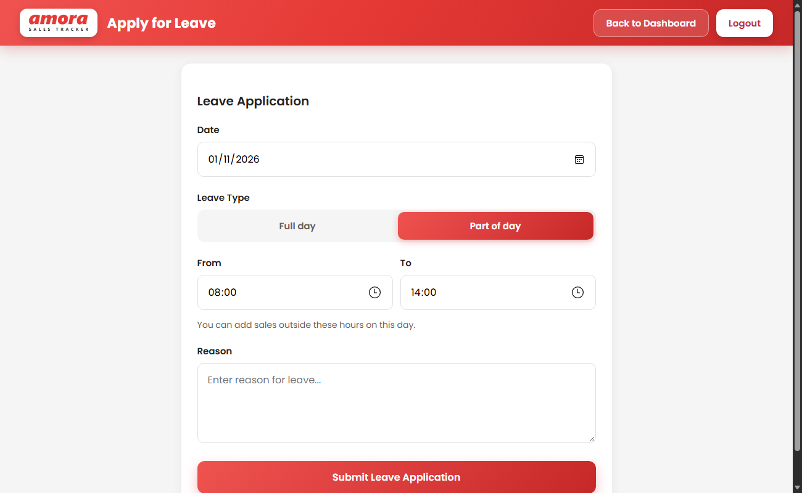

# Amora Sales Tracker

## Live on Live on https://amora-sales.onrender.com/

A full-stack web app for a retail sales team: salespeople record each sale from their phone, apply for leave, and see their own performance; an admin tracks the whole team's sales, approves leave, and manages staff and the product catalogue.

**Live demo:** _add your Render link here_



## Features

**Salesperson**
- Record sales quickly: search a product by model number and the brand, barcode, description and price fill in automatically
- Enter a whole day's sales in one go, with a running list and total for the day
- Personal dashboard: daily and monthly totals, last-7-days trend, sales by month, top brands
- Apply for full-day or part-day leave (e.g. 08:00–14:00)
- Sales are locked during approved leave; with part-day leave they unlock automatically when the leave ends

**Admin**
- Team dashboard: totals, sales by month, brand split, employee comparison, performer of the month
- Daily view shows who is on leave and each salesperson's sales for the day
- Approve, reject, cancel or delete leave requests, with remarks
- Add or remove salespeople and reset passwords
- Download sales and leave reports as CSV
- Import the product catalogue from an Excel/CSV file

**General**
- Responsive design for phones and desktops
- All "today" and leave-hour logic uses UAE time (Asia/Dubai), whatever the device clock says
- Rules such as the leave lock are enforced on the server, not just in the UI
- Admin password reset by emailed one-time code

## Screenshots

| Login | Salesperson dashboard |
|---|---|
|  |  |

| Add sales | Apply for leave |
|---|---|
|  |  |

_Screenshots use fictional demo data._

## Tech stack

| Part | Technology |
|---|---|
| Frontend | React 19, Vite, Recharts |
| Backend | Node.js, Express |
| Database | MongoDB Atlas with Mongoose |
| Other | Nodemailer (OTP email), SheetJS (Excel/CSV import) |
| Hosting | Render (static site + web service) |

## Project structure

```
salesapp/          React frontend (Vite)
  src/App.jsx      Screens: login, dashboards, add sale, apply leave, admin tools
  src/api.js       All calls to the backend
sales-backend/     Express API
  server.js        Routes: auth, users, products, sales, leaves, stats
  models/          Mongoose schemas (User, Product, Sale, Leave)
  routes/          Excel/CSV import endpoints
  scripts/         importDemoData.js — loads the demo dataset
render.yaml        One-click Render deployment (API + website)
```

## Run it locally

You need Node.js 18+ and a MongoDB connection string (a free MongoDB Atlas cluster works).

```bash
# 1. Backend
cd sales-backend
cp .env.example .env        # then put your MONGO_URI in .env
npm install
npm run dev                 # http://localhost:5000

# 2. Frontend (new terminal)
cd salesapp
cp .env.example .env.local  # VITE_API_URL=http://localhost:5000
npm install
npm run dev                 # http://localhost:5173
```

On first start the server creates an admin account for admin (`admin` / `admin123`), for salesman (`emp-001` / `demo123`), (`emp-002` / `demo123`). 
Live on https://amora-sales.onrender.com/


